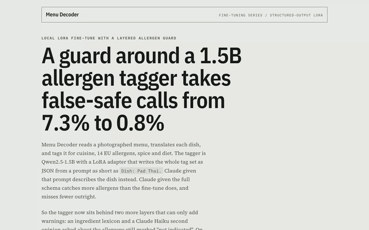
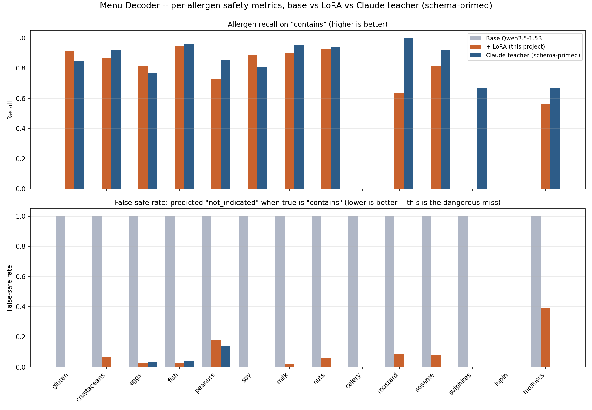

# Menu Decoder

[](https://github.com/lyhjeremy/menu-decoder/actions/workflows/tests.yml)

Photograph a foreign-language menu and get each dish translated and tagged for cuisine, 14 EU allergens, spice and diet by a Qwen2.5-1.5B LoRA fine-tune, with an allergen display that can warn but never clear.



The tagger sits behind a layered allergen guard: an ingredient lexicon and a Claude Haiku second opinion, each able only to add warnings. On 60 adversarial dishes built to hide an allergen, misses fell from 22 of 123 to 0; on the 303 held-out dishes the false-safe rate fell from 7.3% to 0.8%, for $0.18 per 1,000 dishes (API-equivalent) and more warnings (over-warning 6.2% to 8.9%).

[Project page](https://lyhjeremy.github.io/menu-decoder/) · [Write-up](https://lyhjeremy.github.io/menu-decoder/overview/) · [Engineering notes](writeup.md) · [Full benchmark](eval/benchmark.md)

Design and copy follow [these standards](https://github.com/lyhjeremy/lyhjeremy/blob/main/DESIGN_STANDARDS.md).

One of four apps that fine-tune a small local model and benchmark it against Claude, with [Cellar Scanner](https://github.com/lyhjeremy/cellar-scanner), [Race Day Copilot](https://github.com/lyhjeremy/race-day-copilot) and [Receipt Auditor](https://github.com/lyhjeremy/receipt-auditor).

## Results

The tagger takes a one-line prompt (`Dish: Pad Thai.`) and emits JSON with cuisine, a `contains` / `may` / `not_indicated` call for each of 14 allergens, spice, vegetarian and vegan. Held-out test set of 303 synthetic dishes, split by dish family:

| System | N | Valid JSON | Cuisine | Allergen recall | False-safe | Latency |
|---|---|---|---|---|---|---|
| Base Qwen2.5-1.5B, bare prompt | 303 | 0.0% | 0.0% | 0.0% | 100.0% | 5.4 s |
| Qwen2.5-1.5B + LoRA, bare prompt | 303 | **100.0%** | **99.3%** | 69.3% | 7.3% | 6.7 s |
| Claude, bare prompt | 100 | 94.0% | 43.0% | 0.0% | 100.0% | 16.5 s |
| Claude, schema in prompt | 100 | 99.0% | 81.0% | **79.3%** | **1.7%** | 13.4 s |

Allergen recall is macro recall on dishes labeled `contains`. False-safe is the share of `contains` dishes tagged `not_indicated`, the dangerous miss.

Claude's recall is 79.25% unrounded, 79.3% to one decimal as in `eval/guardrails/results.json` (corrected 2026-11-13; this README said 79.2%, which is how `eval/benchmark.md` prints the four-decimal 0.7925 in `eval/benchmark.json`).

Schema-primed Claude costs $0.056 a dish ($56.02 per 1,000) at API prices: the `total_cost_usd` that `claude -p --output-format json` reports, measured on 2026-11-05 by rerunning 25 dishes of its subsample with the benchmark's own prompt and flags ([`eval/claude_cost/`](eval/claude_cost/)). The CLI runs on a Claude subscription, so nothing was billed. The LoRA model costs nothing per call.

With the bare prompt, Claude describes the dish under its own JSON keys and scores zero by construction. With the tagging rubric and output format added, it beats the fine-tune on allergens. What the fine-tune has going for it is that the schema lives in its weights, so the prompt is one line, and it runs locally at no cost per call. Its weakest allergens are molluscs (39.1% false-safe) and peanuts (18.2%).



## Layered allergen guard (2026-11-13)

Each layer can only raise a call (`not_indicated` to `may` to `contains`), so it can only remove false-safe calls; the price is more warnings.

1. LoRA tagger, as benchmarked above.
2. `src/allergen_lexicon.py`: 541 ingredient, sauce, stock and technique words (English and the menu languages, accents folded, no dish names) mapped to allergens. 0.04 ms a dish.
3. `src/allergen_guard.py`: Claude Haiku sees ten dishes per call with the allergens still `not_indicated` and says which ones the standard recipe has. The reply must pass a pydantic schema and an id check, gets one retry, and falls back to `may` on everything if the retry fails. In the app it runs only for the diner's own allergens (`MENU_SECOND_OPINION=0` turns it off).

| Set | Layer | Recall | False-safe | Over-warning | Adds per dish |
|---|---|---|---|---|---|
| Held-out, 303 dishes | LoRA | 69.3% macro | 7.3% macro; 4.6% of slots (30 of 658) | 6.2% | $0 |
| | + lexicon | 79.7% macro | 4.5% macro; 2.6% of slots (17 of 658) | 7.2% | $0 |
| | + Haiku | 82.0% macro | 0.8% macro; 0.3% of slots (2 of 658) | 8.9% | $0.00018, 13 s per batch of 10 |
| Adversarial, 60 dishes (hidden allergens) | LoRA | 53.7% of slots | 17.9% of slots (22 of 123) | 23.3% | $0, 2.8 s median |
| | + lexicon | 65.9% of slots | 8.9% of slots (11 of 123) | 23.5% | $0 |
| | + Haiku | 74.8% of slots | 0.0% of slots (0 of 123) | 27.0% | $0.00018 |

Macro rates average the per-allergen rates, as in the benchmark; slot rates pool every dish-allergen pair labeled `contains` (658 held-out, 123 hidden adversarial). Over-warning is a slot rate over pairs labeled not indicated. All from `eval/guardrails/results.json`. On the 100 held-out dishes schema-primed Claude saw, the guarded tagger scores 81.3% recall and 0.3% false-safe against Claude's 79.3% and 1.7%, at 9.2% over-warning against 3.3%. Three Haiku runs agreed on 94.2% of 514 open slots; run 3 cleared hummus of sesame (hidden false-safe 0.0%, 0.0%, 0.8%). Sonnet as the second opinion also reached 0 misses but over-warned on 32.2% of slots at $0.0021 a dish.

The adversarial set (`eval/guardrails/adversarial_set.json`) was frozen in commit 51c4ae3 before any guard run. Its labels were drafted by a model from standard recipes and are not human-checked; `eval/guardrails/labeling_sheet.csv` (840 rows) is there for that. The same agent wrote the lexicon, so the lexicon's adversarial gain is optimistic; the held-out result is the cleaner measure for it. Reproduce: `python eval/guardrails/run_lora.py adversarial`, `python eval/guardrails/run_guard.py second test|adversarial`, `python eval/guardrails/run_guard.py score`. Results: `eval/guardrails/results.json` and `results.md`.

## Method

`scripts/gen_dishes.py` generated 6,750 rows with `claude -p`: 15 cuisines, 150 dishes each, and three prompt variants per dish (name only, name with description, original script with translation). The split is by dish family, so a dish's three variants always share a side. Row IDs are hashes, so `training/prep_tagger.py` rebuilds the generator's item list to recover the families; that gives 2,250 families and 6,096 train / 351 validation / 303 test rows, and the leakage check passes.

The fine-tune is LoRA on `mlx-community/Qwen2.5-1.5B-Instruct-4bit` with MLX on Apple Silicon (batch 4, 12 layers, 800 iterations, learning rate 1.5e-4, sequence length 768; the median target is about 204 tokens). Unlike the single-label classifiers elsewhere in the series, this one generates a full structured JSON object per dish. `training/bench_tagger.py` scores parse rate, cuisine, spice within 1, vegetarian and vegan agreement, and per-allergen recall and false-safe rate. Claude runs from a scratch directory outside the repo so it can't read the training code.

The fail-safe has three layers. The tagging rubric asks for `may` whenever an allergen is plausible. `src/safelist.py` renders `contains` as a cross, `may` as "ask the staff" and `not_indicated` as "not indicated", and has no green check to show. Then `filter_safe_dishes` removes every `contains` or `may` dish for the user's allergens, and any dish failing a stated diet, before the LLM recommends anything.

Around that, a domain gate refuses non-menu photos, unreadable lines are kept and flagged, recommendations are checked against the extracted dish IDs, and translations and tags are cached on `(original_text, language)`.

## Stack

Python, Gradio, MLX (`mlx_lm`), Qwen2.5-1.5B-Instruct, Pydantic, tesseract, Claude via `claude -p`, Gemini as the batched tagging fallback when no adapter is present, text-to-speech for dish names.

## How to run

```bash
git clone https://github.com/lyhjeremy/menu-decoder && cd menu-decoder
python3 -m venv .venv && source .venv/bin/activate
pip install -r requirements.txt
./setup_ocr.sh                          # tesseract and language packs, one time
python scripts/gen_dishes.py            # synthetic corpus: 6,750 items, a claude -p call each; resumable
python training/prep_tagger.py          # dish-family split train/valid/test
bash training/lora_harness/train.sh mlx-community/Qwen2.5-1.5B-Instruct-4bit \
    data/lora training/adapters 4 12 800 1.5e-4 768
python training/bench_tagger.py         # benchmark, writes to eval/
python app.py
```

Menu extraction uses `claude -p` on a Claude subscription. Tests: `pytest tests/` (25 tests).

## Repo layout

| Path | Contents |
|---|---|
| `app.py` | Gradio app: photo, badged menu, safe picks, dish-name speech |
| `scripts/gen_dishes.py` | Synthetic dish-tagging corpus generator |
| `training/prep_tagger.py` | Dish-family split with leakage check |
| `training/bench_tagger.py` | Four-row benchmark, per allergen |
| `training/make_tagger_chart.py` | Per-allergen chart |
| `src/decoder.py` | Tagging and recommendation prompts |
| `src/safelist.py` | Badge rendering and the deterministic filter |
| `src/allergen_lexicon.py`, `src/allergen_guard.py` | Guard layers 2 and 3 |
| `eval/guardrails/` | Adversarial set, guard eval, outputs, labeling sheet |
| `src/` | Shared toolkit: llm, vision, guardrails, context, cache, audio |
| `eval/` | Benchmark, raw outputs, chart, loss curve, dataset card |

## Limitations

- Every label was generated by Claude, which is also a benchmark column. The spec's human spot-check of about 60 dishes across cuisines has not been done, so the figures measure agreement with synthetic labels.
- The fine-tune's allergen recall (69.3%) is below schema-primed Claude's (79.3%), and it misses rare allergens: 0% recall on sulphites and celery, where it answers `may` instead of `contains`.
- Claude's figures come from a 100-row subsample.
- The fail-safe has a price. Run over the fine-tune's own tags for the 303 test dishes, the safe-list filter leaves no dish for a gluten allergy (137 `contains`, 166 `may`) and 31 for sulphites. The [write-up](https://lyhjeremy.github.io/menu-decoder/overview/) lets you pick allergens and see what survives.
- Not a medical device. Confirm allergens with restaurant staff.

## License

[MIT](LICENSE) © 2026 Jeremy Lee
