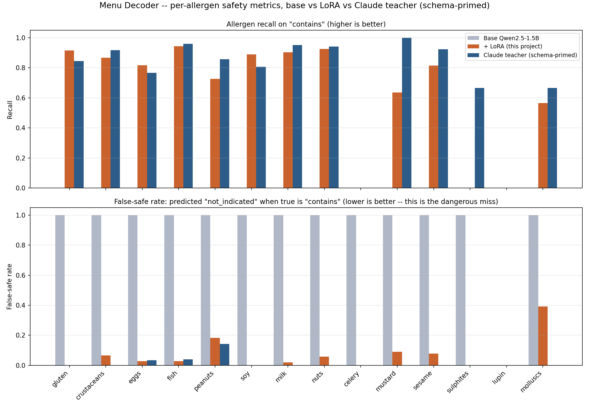

# Menu Decoder: an allergen badge that can warn but never clear

If you ask a chatbot to read a menu you can't read and tell you what's safe to eat, you are trusting it twice: to translate the dish correctly, and to never wave through an allergen it wasn't sure about. The two kinds of mistake don't cost the same. A missed allergen is dangerous, and a false warning costs one question to the waiter. Menu Decoder is built around that asymmetry (`MENU_DECODER_SPEC.md` §2). It reads a photographed menu in any language, translates each dish, and tags it for cuisine, the 14 EU allergens, spice and diet, and nothing in it can tell you a dish is safe.

Design and copy follow [these standards](https://github.com/lyhjeremy/lyhjeremy/blob/main/DESIGN_STANDARDS.md).

The tagger is Qwen2.5-1.5B with a LoRA adapter that learned the whole output schema, so its prompt is one line. On 303 held-out dishes it returns valid tags every time and catches 69.3% of the allergens a dish contains. Claude, given the full schema in its prompt, catches 79.2%. So the small model loses on the number that matters most, and the app is designed on the assumption that it will miss some.

It is one of four apps that each fine-tune a small local model and benchmark it against Claude; the others are [Cellar Scanner](https://github.com/lyhjeremy/cellar-scanner), [Race Day Copilot](https://github.com/lyhjeremy/race-day-copilot) and [Receipt Auditor](https://github.com/lyhjeremy/receipt-auditor).

## Three layers that lean toward warning

Each layer holds even if the other two fail.

The first is the rubric. The synthetic-data generator (`scripts/gen_dishes.py`) and the runtime tagging prompt (`src/decoder.py`) carry the same instruction: answer `contains` when an allergen is a defining or named ingredient, `may` when it is plausible in a typical preparation even if unnamed (sesame oil in many Asian dishes, gluten in most sauces and breading, peanuts in Southeast Asian cooking), and `not_indicated` only where the allergen would be unusual. One sentence does most of the work: "when uncertain, prefer `may` over `not_indicated`".

The second is the renderer. `ALLERGEN_BADGE` in `src/safelist.py` maps `contains` to a cross, `may` to "ask the staff" and `not_indicated` to "not indicated" with an open circle. The table has no entry for a check mark, so a model that decided to be reassuring would have nothing to draw it with.

The third is a filter in code. Before the recommendation call, `filter_safe_dishes` removes every dish marked `contains` or `may` for any of the user's allergens, and every dish that fails a stated vegetarian or vegan diet. The model then picks from the filtered list and has no way to argue a dish back onto it. (Receipt Auditor makes the same split for arithmetic: code decides, and the model phrases.)

## Teaching a 1.5B model the schema

Cellar Scanner and Receipt Auditor fine-tune a single-label classifier. This tagger has to write a whole JSON object per dish: cuisine, a `contains` / `may` / `not_indicated` level for each of 14 allergens, a spice score, and vegetarian and vegan calls.

`scripts/gen_dishes.py` generated 6,750 rows overnight with `claude -p`, covering 15 cuisines with 150 dishes each and three prompt variants per dish: name only, name with description, and original script with translation, such as `"海老柚子味噌漬け丼 (Ebi Yuzu Miso-zuke Don)"`.

The spec requires the split to be by dish family, so that a dish's three variants all land on the same side; otherwise the model could learn a dish's allergens from one variant and get credit for them on another. That turned out to need some digging, because the rows carry no plain family ID. The generator's `_stable_id(cuisine, seq, variant)` hashes all three into a 16-character `item_id` and stores neither `seq` nor `variant`. `training/prep_tagger.py` therefore rebuilds the generator's `build_items()` list and matches each `item_id` back to its `(cuisine, seq, variant)`. Grouping by `dish_name` would have failed, since `"Pad Thai"` and `"ผัดไทย (Pad Thai)"` are different strings. All 6,750 rows matched: 2,250 families, split 90/5/5 into 6,096 train, 351 validation and 303 test rows. The leakage check passed (`eval/dataset_card.json`).

Training was LoRA on Qwen2.5-1.5B-Instruct (4-bit) with MLX on Apple Silicon, with batch 4, 12 layers, 800 iterations, learning rate 1.5e-4 and sequence length 768. I picked the sequence length after measuring the median target with the tokenizer at about 204 tokens. The loss curve is in `eval/loss_curve.png`.

## What the benchmark measures

The spec (§5) asks for recall on `contains`, per allergen, since a missed allergen is the dangerous error, and for the false-safe rate: the share of `contains` cases tagged `not_indicated`. A `may` still produces a warning, so it doesn't count as false-safe. `training/bench_tagger.py` reports both per allergen, along with cuisine accuracy, spice within 1, and vegetarian and vegan agreement.

Base and LoRA ran on all 303 test rows. Claude ran on a 100-row subsample, because `mlx_lm.generate` reloads the model on every call and `claude -p` is slow; a full run of every system would have taken hours.

| System | N | Valid JSON | Cuisine | Spice ±1 | Veg | Vegan | Allergen recall | False-safe | Latency |
|---|---|---|---|---|---|---|---|---|---|
| Base Qwen2.5-1.5B, bare prompt | 303 | 0.0% | 0.0% | 0.0% | 0.0% | 0.0% | 0.0% | 100.0% | 5.4 s |
| Qwen2.5-1.5B + LoRA, bare prompt | 303 | **100.0%** | **99.3%** | **99.0%** | 94.1% | **96.7%** | 69.3% | 7.3% | 6.7 s |
| Claude, bare prompt | 100 | 94.0% | 43.0% | 0.0% | 0.0% | 0.0% | 0.0% | 100.0% | 16.5 s |
| Claude, schema in prompt | 100 | 99.0% | 81.0% | 99.0% | **97.0%** | 96.0% | **79.2%** | **1.7%** | 13.4 s |

Claude has two rows on purpose. The bare-prompt row gets exactly what the LoRA model gets, `"Dish: X."`. The schema row adds `src/decoder.py`'s `TAGGING_SYSTEM` rubric and a single-dish JSON format description, with no answers and no examples.

Given only the dish name, Claude answers a sensible but different question ("tell me about this dish") and returns valid JSON with its own keys: `dish_name_arabic`, `region`, `main_ingredients`, `flavor_profile`. It parses, but none of those keys are scored, so the row is zero. The untrained base model fails for the mirror-image reason; it has no idea what format to produce and writes prose. With the schema, Claude reaches 81.0% on cuisine and 79.2% allergen recall with a 1.7% false-safe rate, which puts it ahead of the fine-tune on allergen safety.

What the fine-tune buys is that the 14-allergen contract sits in its weights. The prompt is one line and the model runs locally at no cost per call, while a zero-shot model needs the full rubric in every call before it can attempt the task at all.

  

A confusion matrix doesn't suit a multi-label task, so the chart plots recall and false-safe rate per allergen for base, LoRA and schema-primed Claude; the bare-prompt Claude row is left out because its allergen fields are never populated. On the common allergens the fine-tune is close to Claude (gluten 91.5% against 84.4%, fish 94.4% against 96.0%, nuts 92.7% against 94.1%), and it falls behind on the rarer ones. Molluscs are the worst case, with 39.1% of mollusc dishes tagged `not_indicated`, followed by peanuts at 18.2%. On sulphites and celery it has 0% recall and no false-safes, which means it answered `may` every time. All 14 allergens are in `eval/benchmark.md`.

## Three bugs the benchmark turned up

The first Claude pass ran `claude -p` from the repo directory. The CLI has file tools on by default, and some calls opened `training/prep_tagger.py`, `scripts/gen_dishes.py` or `src/decoder.py` to work out the target schema before answering. One response began "I don't need the tool for this. I already have the exact target schema (`training/prep_tagger.py`'s `to_tagging_json`...)". Eight of the first 100 responses did something like this.

The obvious fix, `claude -p --tools ""`, made things worse. Most responses turned into narrated tool calls ("Tool: bash", "1 tool used"), and one claimed that a `grep` result had been manipulated by a prompt injection; even with no tools attached, the CLI's system prompt still sets it up as a coding agent. Every metric dropped to about 0%, which was implausible enough that I checked it before writing anything to `eval/benchmark.md`. What worked was running `claude -p` with its working directory set to a scratch folder outside the repo: tools stay on, and there is nothing for them to read. The two prompts that had triggered the leak came back clean, and the full 100-row schema rerun had no contaminated responses.

The third bug was in the app, which had never used the adapter. The LoRA path in `app.py`'s `tag_dishes()` called `DishTags.model_validate_json` on `mlx_lm.generate`'s raw stdout, and that output wraps the answer in a `==========` banner, so parsing could never succeed. `DishTags` also required a `dish_id`, which the training target never contains because IDs are assigned per menu at extraction time. Every call fell into the `except` branch and returned the fail-safe default. The fix extracts the JSON body and re-attaches the menu's `dish_id`, and the 10 tests pass.

## Limitations

Every label was generated by Claude, and Claude is also a benchmark column. The spec (§5) names this circularity and requires a human spot-check of about 60 dishes stratified across cuisines, since agreeing with yourself is a different thing from being right. That check needs me to do it and has not been done. Until it is, the schema-primed Claude row measures how well Claude agrees with its own labels, and every figure here is about synthetic data.

The tagger misses allergens: 69.3% recall overall, and a 39.1% false-safe rate on molluscs. That is why the three fail-safe layers exist. This is not a medical device; confirm allergens with restaurant staff.

---

Built by [Jeremy Lee](https://github.com/lyhjeremy). Code, benchmark and dataset card: [github.com/lyhjeremy/menu-decoder](https://github.com/lyhjeremy/menu-decoder).
